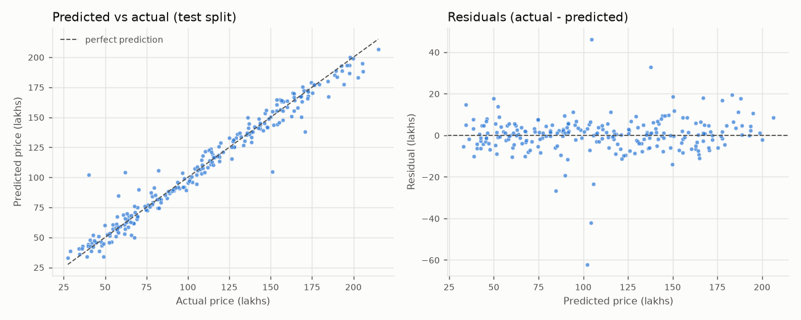

# Evaluation report

Generated by `python -m src.train` (re-check with `python -m src.evaluate`). Deterministic: same data + config + code -> same numbers.

| Item | Value |
|---|---|
| Model | `gradient_boosting` {"n_estimators": 300, "learning_rate": 0.05, "max_depth": 3, "subsample": 0.9} |
| Model file / SHA-256 | `models/model.joblib` / `b09c57dd3b346698...` |
| Raw data md5 | `71a9a5cf87f4278f9577530e728ba46b` (1230 raw rows) |
| Rows after cleaning | 1190 (train 952, test 238) |
| Split | random, test_size=0.2, random_state=42 |

## Held-out test metrics (price in INR lakhs)

| Metric | Value |
|---|---|
| MAE | 5.536 |
| RMSE | 8.918 |
| R2 | 0.9641 |
| MAPE | 6.52% |
| Baseline RMSE (always predict the mean) | 47.082 |
| RMSE reduction vs baseline | 81.1% |

## Stability (cross-validation on the training split only)

5-fold CV RMSE: 7.757 +/- 1.125. The test split is never used for fitting or model selection.

